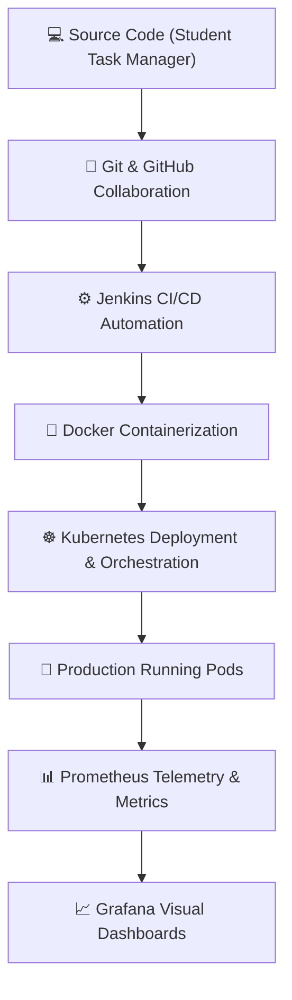

# ⚙️ DevOps for Scalable Systems Lab

  <strong>Practical Lab Work Record · DevOps for Scalable Systems Lab</strong> 
  A comprehensive collection of DevOps assignments implemented using a Student Task Manager application.

  
  
  
  

---

## 📌 About This Repository

This repository serves as the complete practical lab work record for the **DevOps for Scalable Systems Lab (DOSS)**. It documents end-to-end industry-standard DevOps practices, automated pipelines, containerization, orchestration, and real-time observability.

The core project utilized throughout all modules is a **Student Task Manager web application**, providing a tangible practical foundation for exploring DevOps tools, automated builds, scaling, and application monitoring.

---

## 🧪 Assignments & Topics

| Assignment | Area | Concepts & Focus Areas |
|---|---|---|
| [Assignment 1](./Assignment%201) | 🔀 Version Control | Git basics, repository initialization, file staging, commits, remote sync |
| [Assignment 2](./Assignment%202) | 👥 Collaboration | Git branching strategies, pull requests, peer review, and merging |
| [Assignment 3](./Assignment%203) | ⚙️ CI/CD | Jenkins Freestyle pipeline automation, build scripts, npm automation |
| [Assignment 4](./Assignment%204) | 🐳 Containerization | Docker image building, port exposure, and container lifecycle management |
| [Assignment 5](./Assignment%205) | ☸️ Orchestration | Kubernetes Deployment, Pods, NodePort Service, and Minikube |
| [Assignment 6](./Assignment%206) | 🔄 Scalability & Healing | Horizontal replica scaling and automated Kubernetes pod self-healing |
| [Assignment 7](./Assignment%207) | 📊 Monitoring | Prometheus time-series metrics collection, endpoint scraping, and PromQL |
| [Assignment 8](./Assignment%208) | 📈 Visualization | Grafana visual dashboard, data source integration, and telemetry graphs |

---

## 🔄 DevOps Workflow

---

## 🛠️ Technology Stack

  

- **Application:** Node.js, Express.js, Vanilla HTML5 / CSS3 / JavaScript
- **Version Control:** Git, GitHub
- **Continuous Integration:** Jenkins
- **Containerization:** Docker, Docker Desktop
- **Orchestration:** Kubernetes, Minikube, `kubectl`
- **Monitoring & Metrics:** Prometheus, PromQL, `prom-client`
- **Visualization & Alerting:** Grafana

---

## 🎯 Objective

To gain hands-on expertise with fundamental and advanced DevOps methodologies, covering source code management, continuous integration, containerization, cluster orchestration, self-healing architectures, and proactive infrastructure monitoring.

---

  Academic practical work · DevOps for Scalable Systems Lab · Created by @ishwari1201

